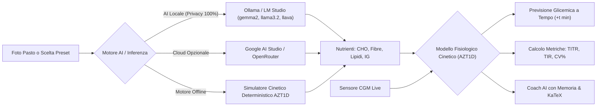

# GlucoTwin — Assistente e Predittore Glicemico Preventivo

> 🇬🇧 **English documentation available:** [Read in English](README.md)

> Gemello digitale metabolico clinico per la gestione del Diabete di Tipo 1: stima l'impatto glicemico a intervalli configurabili prima del pasto, calcola il bolo con formule validate e propone micro-interventi metabolici (hack comportamentali) supportando **AI Locale (Ollama / LM Studio)**, modelli Cloud (Google AI Studio) o **Motore Fisiologico Offline (AZT1D)**.


---

## 🏆 Hacktoberfest 2026 Hack Day a Milano

> 🥇 **1st Place Overall Winner**  
> 🥇 **Best Open-Source AI Project**  
> 🥇 **Best AI for Good**  

---

## 🩺 Il Contesto Clinico

La gestione quotidiana del diabete richiede continue decisioni legate all'alimentazione, all'attività fisica e al dosaggio dell'insulina. I sensori per il monitoraggio in continuo del glucosio (CGM) registrano l'andamento in tempo reale, ma intervengono quando le variazioni sono già in atto. 

**GlucoTwin** ribalta questo paradigma introducendo un approccio **preventivo e predittivo**:
- Permette al paziente di selezionare o fotografare il pasto **prima** di mangiare.
- Simula l'evoluzione della curva a coordinate temporali puntuali ($+15, +30, +45, +60, +90, +120, +180\text{ min}$).
- Valuta l'efficacia di due interventi metabolici scientificamente validati (**pre-carico di fibre** e **camminata GLUT4**).
- Fornisce il calcolo matematico trasparente della dose di insulina rapida con spiegazione delle formule e delle strategie avanzate (es. **bolo a onda doppia** per pasti ricchi di grassi).

---

## ✨ Funzionalità Chiave

### 1. ⏱️ Simulatore Preventivo & Stima Glicemica Puntuale
- Calcolo esatto del valore glicemico atteso al minuto desiderato (es. a $+45\text{ min}$ o $+60\text{ min}$).
- Visualizzazione del valore atteso, del delta rispetto alla glicemia basale CGM e del risparmio glicemico ottenuto con i consigli.
- Orologio dinamico con proiezione dell'ora esatta dell'orologio (es. *"Alle 13:45 la glicemia stimata sarà 138 mg/dL"*).

### 2. 📊 Metriche Cliniche Avanzate di Consenso (ATTD / ADA 2024–2026)
- **TIR (Time-in-Range 70–180 mg/dL):** Percentuale di tempo nel bersaglio standard ($>70\%$).
- **TITR (Time-in-Tight-Range 70–140 mg/dL):** La nuova frontiera del consenso clinico per minimizzare le oscillazioni subcliniche ($\ge 50\%$).
- **CV% (Coefficiente di Variabilità Glicemica):** Calcolo in tempo reale di $\text{SD}/\text{Media} \times 100\%$ con badge di stabilità clinica (target $\le 36\%$).
- **Allerte Precoci Proattive:** Allarmi predittivi per rischio ipoglicemia ($<70\text{ mg/dL}$ con classificazione di severità), picchi elevati e velocità di ascesa ($>2.0\text{ mg/dL/min}$).

### 3. 🔬 Validazione su Dataset Clinico Reale (Studio AZT1D 2025)
- Calibrato sui profili cinetici di **25 soggetti con Diabete Tipo 1** dotati di microinfusore automatico AID e sensori CGM Dexcom, con oltre **306.712 rilevazioni campionate ogni 5 minuti**.
- Benchmark di popolazione integrato: TIR medio $77.8\%$, TAR $20.6\%$, TBR $1.5\%$, CGM medio $142.3\text{ mg/dL}$, CV $32.1\%$.

### 4. 💬 Coach AI Clinico con Memoria Multi-Turn & Trasparenza $\LaTeX$
- **Memoria di Conversazione:** Mantiene il contesto delle domande precedenti senza perdere il filo del discorso.
- **Timing Ottimale del Bolo:** Guida clinica personalizzata sui minuti di anticipo dell'iniezione prima del pasto in base al valore CGM di partenza e alla composizione del piatto.
- **Alternative e Sostituzioni a Basso IG:** Suggerisce swap alimentari concreti (es. pasta 100% legumi o integrale al dente, pinsa a lunga lievitazione, riso basmati/venere, porridge d'avena).
- **Formule Matematiche Visibili:** Rendering $\LaTeX$ ad alta risoluzione con KaTeX per tutti i calcoli (Bolo pasto, correzione, sconto moto $-20\%$, IOB residua).
- **Pillole Rapide Scorribili:** Frecce laterali fisse `<` e `>`, scorrimento con rotella del mouse, drag/touch e zero barre di scorrimento visibili.

### 5. 📸 Vision AI Interattiva & Carb-Counting con Regolazione Porzione
- Analisi automatica di piatti reali tramite modelli multimodali (Ollama Llava / Llama Vision o Gemini Cloud).
- Finestra modale interattiva: permette all'utente di visualizzare l'anteprima della foto, modificare il nome del piatto e calibrare la stima dei carboidrati ($\pm 5\text{g}$) per porzioni più abbondanti o ridotte.
- Catalogo pasti preimpostati (pasta al pomodoro, carbonara, pizza margherita, risotto ai funghi, poke salmone, toast farcito, insalata tonno, colazione italiana, brioche).

### 6. 📖 Nuova Pagina Completa "Info & Clinica"
- Scheda dedicata integrata nella navigazione principale con:
  - Analisi dettagliata del dataset AZT1D (2025).
  - Fisiologia della traslocazione dei recettori **GLUT4** muscolari e della barriera vischiosa delle **fibre idrosolubili**.
  - Visualizzazione trasparente delle 4 formule del bolo con `String.raw` KaTeX.
  - Spiegazione del **Bolo ad Onda Doppia** ($60\%$ subito, $40\%$ su 2–3 ore) per pasti ad alto tenore lipidico ($\ge 20\text{g}$).
  - Architettura Local-First e privacy sanitaria.
  - Glossario completo (TIR, TITR, I:C, FSI, IOB, CV%).

### 7. 📐 Layout Zero Sovrapposizione (Dedicated Gutter)
- La chat del Coach AI rimane fissata a schermo durante lo scrolling su desktop, ma è confinata in uno spazio orizzontale riservato (`lg:pr-[415px]`) che garantisce **0px di sovrapposizione** con le card della dashboard su qualsiasi risoluzione o livello di zoom.
- Su mobile e tablet la chat è collocata ordinatamente sotto la dashboard con pulsanti dedicati di apertura e chiusura.

---

## 🏗️ Architettura del Sistema



### Le 3 Modalità di Esecuzione:
1. **🖥️ Locale (Ollama / LM Studio):** I dati sanitari non lasciano mai il computer del paziente. L'applicazione si connette ad endpoint Ollama locale (`http://localhost:11434`) o compatibili OpenAI.
2. **🔒 Motore Clinico Offline (Integrato):** Non richiede connessione Internet né software esterno. Esegue calcoli cinetici e risposte cliniche con formule matematiche istantanee.
3. **☁️ Cloud (Google AI Studio / OpenRouter):** Configurabile con API Key per chi desidera usare modelli avanzati in cloud.

---

## 📁 Struttura del Repository

```text
hacktoberfest2026/
├── backend/                  # API FastAPI e moduli di predizione AI
│   ├── ai/                   # Modelli, cinetica e configurazione AI
│   │   ├── coach.py          # Assistente conversazionale con memoria multi-turn
│   │   ├── config.py         # Connettore Ollama locale, LM Studio, GenAI, OpenRouter
│   │   ├── demo_meals.py     # Catalogo pasti clinici di riferimento
│   │   ├── predictor.py      # Simulatore cinetico AZT1D, TITR, CV% e allerte precoci
│   │   ├── utils.py          # Parser resiliente JSON e MIME type scanner
│   │   └── vision.py         # Vision AI multimodale con carb-counting e taratura
│   ├── sito/                 # Endpoint REST FastAPI
│   │   ├── routes.py         # Route (/api/predict, /api/analyze, /api/chat, /api/ai/status)
│   │   └── schemas.py        # Schemi Pydantic con supporto cronologia chat
│   ├── tests/                # Test automatizzati pytest
│   │   └── test_ai_system.py # 11 test per cinetica, formule, CV%, TITR e memoria chat
│   ├── .env.example          # Template variabili d'ambiente
│   ├── main.py               # Entrypoint applicazione Uvicorn
│   └── requirements.txt      # Dipendenze Python
├── data/                     # Dati clinici e documentazione trial AZT1D
├── datasets/                 # Dataset CSV e JSON (Dexcom, Libre, Nightscout, AZT1D)
├── frontend/                 # Applicazione React con Tailwind CSS v4
│   ├── src/
│   │   ├── App.jsx           # Dashboard, selettore AI, KPI, pagina Info e modal Vision
│   │   ├── BolusCalculator.jsx # Modulo calcolo guidato del bolo con formule
│   │   ├── ChatCoach.jsx     # Chat clinica con formule KaTeX e pillole scorribili
│   │   ├── GlucoseChart.jsx  # Grafico cinetico Recharts con fasce target
│   │   └── index.css         # Design system Daylight Consumer Health
│   ├── package.json          # Dipendenze Node.js
│   └── vite.config.js        # Configurazione Vite
└── README.md                 # Documentazione del progetto
```

---

## 🚀 Istruzioni per l'Avvio Rapido

### Prerequisiti
- **Python 3.10+**
- **Node.js 18+**
- *(Opzionale per AI locale)* [Ollama](https://ollama.com/)

---

### 1. Avvio dell'AI Locale con Ollama (Opzionale ma Consigliato)
```bash
# Scarica ed esegui un modello leggero e veloce
ollama run gemma2:2b

# (Opzionale) Per l'analisi da fotocamera con computer vision locale
ollama pull llava
```
Ollama rimarrà in ascolto su `http://localhost:11434` e verrà rilevato automaticamente dal backend.

---

### 2. Avvio del Backend (FastAPI)
```bash
cd backend

# Crea e attiva l'ambiente virtuale
python -m venv .venv

# Su Windows (PowerShell):
.\.venv\Scripts\Activate.ps1
# Su Linux/macOS:
source .venv/bin/activate

# Installa le dipendenze
pip install -r requirements.txt

# Avvia il server
python -m uvicorn main:app --reload --port 8000
```
API disponibile su `http://localhost:8000` (documentazione Swagger su `http://localhost:8000/docs`).

#### Esecuzione Test Automatizzati:
```bash
pytest tests/ -v
# Output: 11 passed in ~7s
```

---

### 3. Avvio del Frontend (React + Vite)
In un terminale separato:
```bash
cd frontend

# Installa i pacchetti npm
npm install

# Avvia il dev server
npm run dev
```
Apri nel browser `http://localhost:5173`.

---

## 🛡️ Considerazioni di Sicurezza Clinica ed Etica
GlucoTwin è uno strumento sviluppato per finalità educative, di studio e di supporto comportamentale preventivo:
- Non sostituisce il giudizio clinico né le indicazioni del diabetologo curante.
- Tutti i calcoli relativi all'insulina sono stime matematiche trasparenti da verificare sempre con il proprio team medico.
- Gli interventi suggeriti riguardano modifiche comportamentali non farmacologiche (ordine di assunzione dei cibi e attività fisica blanda post-prandiale) volte a favorire la stabilità glicemica nel tempo.
