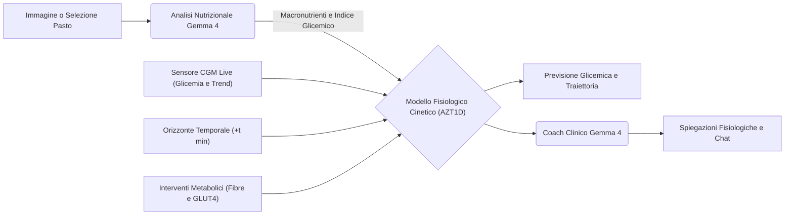

# Gluco — Simulatore e Predittore Glicemico Preventivo

> Calcola la stima della glicemia a intervalli di tempo configurabili prima di iniziare il pasto e valuta l'impatto di interventi metabolici mirati con il supporto dell'intelligenza artificiale di Google Gemma 4.


---

## Il Contesto Clinico
La gestione quotidiana del diabete richiede continue decisioni legate all'alimentazione, all'attività fisica e al dosaggio dell'insulina. I sensori per il monitoraggio in continuo del glucosio (CGM) registrano l'andamento in tempo reale, ma intervengono quando le variazioni sono già in atto. Stimare in anticipo l'impatto nutrizionale di un piatto aiuta a prevenire picchi glicemici marcati e a ridurre il carico decisionale della persona.

---

## Obiettivi del Progetto

1. **Stima Glicemica a Tempo (+t min)**
   - Calcola il valore glicemico atteso a diversi orizzonti temporali (ad esempio a +15, +30, +45, +60, +90, +120 o +180 minuti).
   - Mostra il valore previsto, il delta rispetto alla glicemia iniziale e la fascia di riferimento (Target 70–180 mg/dL, bersaglio ottimale o soglia di attenzione).

2. **Interventi Metabolici Comportamentali**
   - Confronta la curva di assorbimento standard con quella ottenibile applicando interventi non invasivi, come il pre-carico di fibre vegetali prima del pasto e una camminata attiva di 15 minuti per stimolare i recettori GLUT4 muscolari.
   - Fornisce una quantificazione numerica della riduzione dell'escursione glicemica.

3. **Calibrazione su Dati Clinici Reali (Trial AZT1D)**
   - I profili di assorbimento e i parametri del modello cinetico sono allineati ai riscontri dello studio clinico AZT1D (25 persone con diabete di tipo 1 monitorate con microinfusore automatico e sensore CGM, oltre 306.000 registrazioni).
   - Monitoraggio delle metriche di consenso internazionale: Time in Range (TIR 70–180 mg/dL), Time Above Range (TAR >180 mg/dL) e Time Below Range (TBR <70 mg/dL).

4. **Analisi Nutrizionale dei Pasti**
   - Riconoscimento della composizione del piatto (carboidrati netti, fibre, grassi, proteine e indice glicemico) supportato da modelli di visione Gemma 4 o selezionabile da una lista di pasti quotidiani.

5. **Supporto Conversazionale e Calcolo Trasparente del Bolo**
   - Assistente integrato in grado di rispondere a quesiti su cinetica, tempi di assorbimento e calcolo del bolo insulinico (Rapporto Insulina/Carboidrati, Fattore di Sensibilità, Insulina Attiva ed eventuale estensione per pasti ricchi di grassi).

---

## Architettura del Sistema



- **Backend:** Python 3.10+, FastAPI, Google GenAI SDK / OpenRouter per Gemma 4.
- **Frontend:** React 19, Vite, Tailwind CSS v4, Recharts, KaTeX per formule matematiche, Lucide Icons.
- **Privacy e Trattamento Dati:** Il sistema e i modelli a pesi aperti sono predisposti per l'esecuzione on-premise su infrastrutture locali senza dispersione di dati sanitari.

---

## Struttura del Repository

```text
hacktoberfest2026/
├── backend/                  # API FastAPI e moduli di predizione
│   ├── ai/                   # Modelli, cinetica e prompt Gemma 4
│   │   ├── coach.py          # Assistente conversazionale clinico
│   │   ├── config.py         # Configurazione ambienti e modelli
│   │   ├── demo_meals.py     # Database pasti di riferimento
│   │   ├── predictor.py      # Simulatore fisiologico e calcolo a tempo (+t min)
│   │   ├── utils.py          # Funzioni ausiliarie per parsing JSON
│   │   └── vision.py         # Analisi nutrizionale da immagine
│   ├── sito/                 # Endpoint REST e schemi di validazione
│   │   ├── routes.py         # Route FastAPI (/api/predict, /api/analyze, /api/chat)
│   │   └── schemas.py        # Modelli Pydantic
│   ├── .env.example          # Esempio di configurazione variabili d'ambiente
│   ├── main.py               # Punto di ingresso dell'applicazione FastAPI
│   └── requirements.txt      # Dipendenze Python
├── data/                     # Dati clinici e documentazione trial AZT1D
│   ├── AZT1D_DATASET_SUMMARY_FOR_AI.txt
│   └── stressdiabete.txt
├── frontend/                 # Applicazione web React
│   ├── src/
│   │   ├── App.jsx           # Dashboard, scheda previsione a tempo e controlli
│   │   ├── BolusCalculator.jsx # Modulo calcolo trasparente del bolo
│   │   ├── ChatCoach.jsx     # Chat interattiva con rendering formule LaTeX
│   │   ├── GlucoseChart.jsx  # Grafico cinetico con ago temporale
│   │   └── index.css         # Stili e design system
│   ├── package.json          # Dipendenze Node.js
│   └── vite.config.js        # Configurazione Vite
├── .gitignore                # File esclusi dal tracciamento git
└── README.md                 # Documentazione del progetto
```

---

## Istruzioni per l'Avvio

### Prerequisiti
- Python 3.10 o superiore
- Node.js 18 o superiore

### 1. Avvio del Backend (FastAPI)

Dalla cartella `backend`:
```bash
cd backend

# Crea e attiva l'ambiente virtuale
python3 -m venv .venv
source .venv/bin/activate

# Installa le dipendenze
pip install -r requirements.txt

Configura facoltativamente la chiave API in `.env` (se assente, il sistema opera in modalità simulatore locale offline):
```bash
cp .env.example .env
```

Avvia il server:
```bash
python -m uvicorn main:app --reload --port 8000
```
Il servizio risponde su `http://localhost:8000` (documentazione interattiva su `http://localhost:8000/docs`).

---

### 2. Avvio del Frontend (React)

In un terminale separato, accedi alla cartella `frontend`:
```bash
cd frontend

# Installa i pacchetti npm
npm install

# (Opzionale) Esegui la build di produzione per verificare che sia tutto pulito
npm run build

# Avvia il dev server
npm run dev
```

Apri nel browser l'indirizzo indicato: `http://localhost:5173`.

---

## Considerazioni di Sicurezza Clinica ed Etica
Gluco è uno strumento sviluppato per finalità educative, di studio e di supporto comportamentale preventivo:
- Non sostituisce il giudizio clinico né le indicazioni fornite dal proprio medico diabetologo.
- I calcoli relativi all'insulina sono stime matematiche trasparenti che devono sempre essere verificate e concordate con il team sanitario curante.
- Gli interventi suggeriti riguardano modifiche comportamentali non farmacologiche (ordine di assunzione dei cibi e attività fisica blanda post-prandiale) finalizzate a migliorare la stabilità glicemica nel tempo.