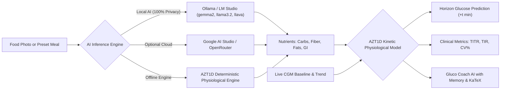

# GlucoTwin — Predictive & Preventive Glycemic Copilot

> 🇮🇹 **Documentazione disponibile in lingua italiana:** [Leggi in Italiano](README.it.md)

> A clinical-grade metabolic digital twin for Type 1 Diabetes management: simulates post-prandial glycemic excursions across configurable time horizons prior to meal consumption, calculates transparent bolus dosing using validated clinical equations, and guides patients with non-pharmacological metabolic interventions (GLUT4 translocation & fiber preloading) supporting **Local AI (Ollama / LM Studio)**, Cloud LLMs (Google AI Studio / OpenRouter), and an **Offline Deterministic Physiological Engine (AZT1D)**.


---

## 🏆 Hacktoberfest 2026 Hack Day in Milan

> 🥇 **1st Place Overall Winner**  
> 🥇 **Best Open-Source AI Project**  
> 🥇 **Best AI for Good**  

---

## 🩺 Clinical Context: Moving from Reactive to Preventive Care

Living with diabetes requires dozens of daily decisions regarding carbohydrates, physical activity, and insulin dosing. Continuous Glucose Monitors (CGM) report interstitial glucose trends in real time, but their alarms are inherently **reactive** — notifying the user only after glycemic swings and spikes have already begun.

**GlucoTwin** flips this paradigm into **preventive, proactive care**:
- Patients select or photograph their meal **before taking the first bite**.
- The simulator models the complete post-prandial absorption curve at discrete time horizons ($+15, +30, +45, +60, +90, +120, +180\text{ min}$).
- The system evaluates the clinical efficacy of two scientifically validated metabolic interventions: **vegetable fiber preloading** and **post-meal GLUT4 walking**.
- Transparent mathematical bolus equations explain dosing step-by-step (Insulin-to-Carb Ratio, Insulin Sensitivity Factor, Active Insulin, and **Dual-Wave Bolus** strategies for high-fat meals).

---

## ✨ Key Features

### 1. ⏱️ Pre-Meal Preventive Horizon Simulator (+t min)
- Computes exact projected glucose values at the patient's chosen time horizon (e.g. at $+45\text{ min}$ or $+60\text{ min}$).
- Visualizes projected glucose, delta from live baseline CGM, and net glucose savings achieved through behavioral interventions.
- Real-time wall-clock projection (e.g., *"At 13:45 your projected glucose will be 138 mg/dL with interventions"*).

### 2. 📊 International Clinical Consensus Metrics (ATTD / ADA 2024–2026)
- **TIR (Time-in-Range 70–180 mg/dL):** Standard consensus benchmark ($>70\%$).
- **TITR (Time-in-Tight-Range 70–140 mg/dL):** The modern consensus frontier for eliminating asymptomatic glycemic variability ($\ge 50\%$).
- **CV% (Coefficient of Glycemic Variation):** Real-time calculation of $(\text{SD} / \text{Mean}) \times 100\%$ with clinical stability indicators (target $\le 36\%$).
- **Proactive Predictive Alerts:** Early warnings for projected hypoglycemia ($<70\text{ mg/dL}$ with Level 1 / Level 2 severity categorization), impending hyper peaks, and rate-of-climb indicators ($>2.0\text{ mg/dL/min}$).

### 3. 🔬 Validated on Real-World Clinical Data (AZT1D Trial 2025)
- Calibrated on the physiological dynamics of **25 subjects with Type 1 Diabetes** managed with automated insulin delivery (AID) closed-loop systems and Dexcom CGM sensors, covering over **306,712 five-minute glucose recordings**.
- Population reference benchmarks: Mean TIR $77.8\%$, TAR $20.6\%$, TBR $1.5\%$, Mean Glucose $142.3\text{ mg/dL}$, CV $32.1\%$.

### 4. 💬 Gluco Coach AI: Multi-Turn Memory & KaTeX Transparency
- **Conversational Memory:** Preserves multi-turn dialogue history across user queries without losing context.
- **Optimal Bolus Timing:** Personalized clinical advice on pre-bolus intervals (e.g. 10–15 min for normal glucose, 20–25 min for elevated baselines, immediate dosing for low initial values).
- **Low-GI Food Swaps & Alternatives:** Tailored metabolic substitutions for pasta, pizza, risotto, and breakfasts (e.g. pulse pasta, stone-ground long-fermentation pinsa, high-amylose basmati, oat beta-glucans).
- **Mathematical Transparency:** High-resolution KaTeX rendering for all formulas (carb bolus, correction factor, $-20\%$ exercise discount, active IOB deduction).
- **Navigation Controls:** Fixed lateral `<` and `>` arrow buttons, mouse-wheel translation, touch drag, and zero distracting scrollbars.

### 5. 📸 Multimodal Vision AI with Interactive Portion Calibration
- Automated macronutrient extraction from dish photos via multimodal LLMs (Ollama Llava / Llama Vision or Gemini Cloud).
- Interactive verification modal: enables users to preview dish photos, edit the meal name, and adjust estimated carbohydrate grams ($\pm 5\text{g}$) to match real-world portion sizes.
- Built-in clinical preset meals (Pasta Pomodoro, Carbonara, Pizza Margherita, Porcini Risotto, Salmon Poke Bowl, Toasted Sandwich, Tuna Salad, Italian Breakfast, Croissant).

### 6. 📖 Complete Clinical Guide & Information Page
- Dedicated in-app tab containing:
  - Scientific methodology and the AZT1D clinical trial dataset.
  - Cellular mechanics of **GLUT4 muscular translocation** and **viscous soluble fiber gel barriers**.
  - ADA/ATTD bolus equations rendered with high-precision KaTeX.
  - Explanation of the **Dual-Wave Bolus** (60% immediate, 40% over 2–3 hours) for high-fat meals ($\ge 20\text{g}$ lipids).
  - Local-first architecture and patient data privacy.
  - Comprehensive clinical glossary (TIR, TITR, I:C, ISF, IOB, CV%).

### 7. 📐 Zero-Overlap Layout (Dedicated Gutter Architecture)
- Desktop chat panel remains fixed in place on screen during vertical scrolling, bounded by a dedicated right gutter (`lg:pr-[415px]`) that physically guarantees **0px overlap** with dashboard cards at any zoom or resolution.
- Responsive mobile & tablet layout positions the coach below dashboard cards for clean viewing.

---

## 🏗️ System Architecture



### 3 Flexible Execution Modes:
1. **🖥️ Local (Ollama / LM Studio):** Health data never leaves the user's workstation. Automatically connects to local Ollama endpoints (`http://localhost:11434`) or OpenAI-compatible servers. Recommended models: `gemma2:2b`, `llama3.2:3b`, `llava`.
2. **🔒 Integrated Offline Clinical Engine:** Zero external software or internet required. Executes deterministic kinetic models and LaTeX bolus equations instantly with $<10\text{ms}$ response latency.
3. **☁️ Cloud (Google AI Studio / OpenRouter):** Configurable via API key for cloud-hosted Gemini and Gemma models.

---

## 📁 Repository Structure

```text
hacktoberfest2026/
├── backend/                  # FastAPI backend & AI predictive modules
│   ├── ai/                   # Physiological models and LLM connectors
│   │   ├── coach.py          # Multi-turn conversational clinical coach
│   │   ├── config.py         # Ollama, LM Studio, Google GenAI & OpenRouter handlers
│   │   ├── demo_meals.py     # Preset clinical meal catalogue
│   │   ├── predictor.py      # AZT1D kinetic model, TITR, CV% and early alerts
│   │   ├── utils.py          # Resilient JSON parser and MIME detector
│   │   └── vision.py         # Multimodal vision AI with carb calibration
│   ├── sito/                 # FastAPI REST API endpoints
│   │   ├── routes.py         # Routes (/api/predict, /api/analyze, /api/chat, /api/ai/status)
│   │   └── schemas.py        # Pydantic validation schemas with chat history
│   ├── tests/                # Automated pytest suite
│   │   └── test_ai_system.py # 11 unit & integration tests (kinetics, bolus, TITR, CV%)
│   ├── .env.example          # Environment variable template
│   ├── main.py               # Uvicorn entrypoint
│   └── requirements.txt      # Python dependencies
├── data/                     # AZT1D clinical documentation and trial specs
├── datasets/                 # CGM datasets (Dexcom, Libre, Nightscout, AZT1D)
├── frontend/                 # React web application with Tailwind CSS v4
│   ├── src/
│   │   ├── App.jsx           # Main dashboard, tab routing, KPI cards, Vision modal
│   │   ├── BolusCalculator.jsx # Guided bolus calculator with formula breakdowns
│   │   ├── ChatCoach.jsx     # Interactive chat with KaTeX math and scrollable pills
│   │   ├── GlucoseChart.jsx  # Recharts kinetic trajectory with target bands
│   │   └── index.css         # Daylight Consumer Health design system
│   ├── package.json          # Node.js dependencies
│   └── vite.config.js        # Vite bundler configuration
├── README.it.md              # Documentazione completa in lingua italiana
└── README.md                 # Primary English documentation
```

---

## 🚀 Quick Start Guide

### Prerequisites
- **Python 3.10+**
- **Node.js 18+**
- *(Optional for local AI)* [Ollama](https://ollama.com/)

---

### 1. Local AI with Ollama (Recommended)
```bash
# Download and launch a lightweight model
ollama run gemma2:2b

# (Optional) For local vision-based meal recognition
ollama pull llava
```
Ollama will listen on `http://localhost:11434` and is automatically detected by the GlucoTwin backend.

---

### 2. Backend Setup (FastAPI)
```bash
cd backend

# Create and activate virtual environment
python -m venv .venv

# On Windows (PowerShell):
.\.venv\Scripts\Activate.ps1
# On Linux/macOS:
source .venv/bin/activate

# Install dependencies
pip install -r requirements.txt

# Launch FastAPI server
python -m uvicorn main:app --reload --port 8000
```
Interactive Swagger documentation is available at `http://localhost:8000/docs`.

#### Running Automated Tests:
```bash
pytest tests/ -v
# Output: 11 passed in ~7s
```

---

### 3. Frontend Setup (React + Vite)
In a separate terminal:
```bash
cd frontend

# Install npm packages
npm install

# Launch development server
npm run dev
```
Open `http://localhost:5173` in your browser.

---

## 🛡️ Clinical & Ethical Safety Disclaimer
GlucoTwin is a scientific prototype developed for educational, research, and preventive decision-support purposes:
- It does **not** replace professional clinical judgment or instructions from a certified endocrinologist/diabetologist.
- All insulin dosing recommendations are transparent mathematical approximations that must be verified against personal clinical prescriptions.
- Recommends non-pharmacological behavioral modifications (meal sequencing and gentle post-meal activity) aimed at fostering glycemic stability.
