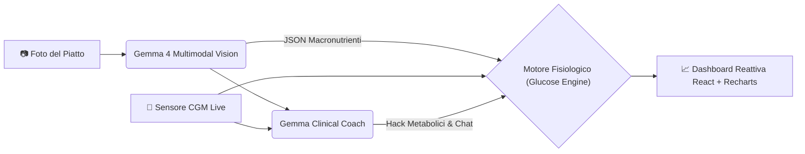

# 🩸 GlucoTwin AI — Simulatore Metabolico Preventivo Open-Weight

> **Prevedi il picco glicemico prima della prima forchettata. Appiattisci la curva con micro-interventi comportamentali personalizzati e l'AI multimodale Gemma.**


---

## 🎯 Il Problema
Una persona con diabete prende circa **180 decisioni extra ogni giorno** legate al cibo. I sensori continui di glicemia (CGM) attuali sono **reattivi**: avvisano il paziente solo *dopo* che il picco iperglicemico è già avvenuto. Inoltre, contare manualmente i grammi di carboidrati, fibre e grassi a ogni pasto genera un enorme carico cognitivo (*diabetes burnout*).

## 💡 La Soluzione: GlucoTwin AI
**GlucoTwin AI** trasforma la gestione glicemica da reattiva a **preventiva**. Basta scattare una foto al piatto o selezionare un pasto demo per:
1. **Stimare istantaneamente i macronutrienti** (Carboidrati, Fibre, Grassi, Proteine e Indice Glicemico) tramite **Gemma 4** (`gemma-4-26b-a4b-it`) nativamente multimodale.
2. **Visualizzare il futuro a 3 ore:** Un motore matematico fisiologico proietta sul grafico la curva glicemica prevista a partire dal valore attuale del sensore CGM.
3. **Simulare "Hack Metabolici" (What-If Engine):** Un agente clinico suggerisce micro-azioni scientificamente validate (es. *pre-carico di fibre* per creare una barriera viscosa intestinale o *attivazione muscolare GLUT4 post-pasto*) mostrando in tempo reale come la curva rossa si appiattisce e rientra nel **Target Range (70–180 mg/dL)**.
4. **Conversare con il Coach Clinico (Gemma):** Poni domande in tempo reale sul calcolo matematico trasparente del bolo, sulla cinetica di assorbimento o sull'effetto dell'attività fisica.

---

## 🧠 Architettura Multi-Modello (100% Open-Weight)

Perché abbiamo scelto modelli **Open-Weight**? 
I dati sanitari e nutrizionali dei pazienti sono tra i più sensibili al mondo (Art. 9 GDPR). La nostra architettura può essere ospitata **On-Premise** direttamente sui server di ospedali, cliniche o dispositivi personali, garantendo **zero data-leak**.



* **👁️ Vision & Carbohydrate Counting:** `gemma-4-26b-a4b-it` (Google GenAI / OpenRouter) per l'analisi visiva delle porzioni e la scomposizione bromatologica strutturata in JSON.
* **🩺 Clinical & Behavioral Coach Agent:** `gemma-4-26b-a4b-it` per la formulazione di strategie di mitigazione e per rispondere alle domande dell'utente (calcolo del bolo carboidrati/correzione, riduzione per moto, bolo prolungato per i grassi).
* **📐 Simulatore Farmacocinetico dell'Assorbimento:** Modello matematico deterministico che calcola la velocità di svuotamento gastrico (rallentata da lipidi e fibre, es. *"effetto pizza"*) e l'escursione glicemica post-prandiale a 60 fps.

---

## 🚀 Quick Start (Avvio Rapido)

### Prerequisiti
* **Python 3.10+**
* **Node.js 18+**
* *(Opzionale)* Una chiave API di **Google Gemini / AI Studio** o **OpenRouter** (il sistema include comunque una modalità **Demo Fallback** integrata funzionante 100% offline).

---

### 1. Avvio Backend (FastAPI)

```bash
cd backend
pip install -r requirements.txt
uvicorn main:app --reload --port 8000
```
Il server sarà attivo su: **`http://localhost:8000`** (documentazione Swagger su `http://localhost:8000/docs`).

---

### 2. Avvio Frontend (React + Vite + TailwindCSS)

```bash
cd frontend
npm install
npm run dev
```
Apri il browser su: **`http://localhost:5173`**.

---

## 🛡️ Sicurezza Clinica & Etica (By Design)
**GlucoTwin AI** è progettato come **sistema di supporto decisionale comportamentale ed educativo**.
* ❌ **Non sostituisce la prescrizione medica** né impone dosaggi rigidi di farmaci.
* ✅ Mostra calcoli matematici trasparenti educativi (Rapporto I:C, Fattore di Sensibilità FSI, Insulina Attiva IOB) da validare sempre con il proprio team diabetologico.
* ✅ Agisce su leve comportamentali validate (sequenza dei macronutrienti e movimento post-prandiale) per massimizzare il **Time-in-Range (TIR)**.