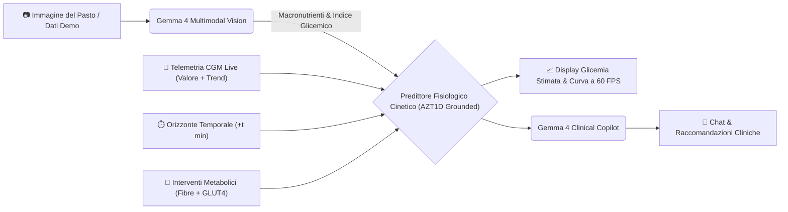

# 🩸 GlucoTwin AI — Simulatore Metabolico Preventivo Open-Weight

> **Prevedi la glicemia stimata dopo tot tempo prima del primo boccone. Appiattisci la curva con interventi metabolici personalizzati e l'AI di Google Gemma 4.**


---

## 🎯 Il Problema Clinico
Una persona con diabete prende circa **180 decisioni extra ogni giorno** legate al cibo. I sensori continui di monitoraggio glicemico (CGM) tradizionali sono prevalentemente **reattivi**: avvisano il paziente quando l'escursione iperglicemica o ipoglicemica è già in atto. Inoltre, il calcolo manuale dei grammi di carboidrati, lipidi e fibre a ogni pasto genera un carico cognitivo cronico (*diabetes burnout*).

---

## 💡 La Soluzione: GlucoTwin AI
**GlucoTwin AI** trasforma la gestione metabolica da reattiva a **preventiva e predittiva**:

1. **⏱️ Calcolo della Glicemia Stimata a Tempo ($+t$ min):**
   - Calcola e mostra con precisione millimetrica il valore glicemico atteso a qualsiasi intervallo temporale (es. $+15$, $+30$, $+45$, $+60$, $+90$, $+120$, $+180$ minuti).
   - Display a grande contrasto con indicazione del delta glicemico e badge clinico di sicurezza (*Bersaglio Ideale 70–140 mg/dL*, *Nel Target 70–180 mg/dL*, *Allerta Iperglicemia*).
2. **🥗 Interventi Metabolici Personalizzati (What-If Engine):**
   - Confronta istantaneamente la curva **Standard** con la curva **Con Interventi Metabolici** (pre-carico di fibre vegetali e stimolazione recettoriale GLUT4 via camminata post-prandiale).
   - Quantifica il risparmio glicemico netto in tempo reale (es. **$-36\text{ mg/dL}$** al picco).
3. **📊 Calibrazione su Dati Clinici Reali (Studio AZT1D 2025):**
   - Modello cinetico calibrato sulle evidenze del trial clinico **AZT1D** (25 soggetti con diabete di tipo 1 equipaggiati con microinfusori automatici AID e sensori CGM, oltre 306.000 rilevazioni continue).
   - Monitoraggio delle metriche di consenso internazionale: **TIR (Time-in-Range 70–180 mg/dL)**, **TAR (Time-Above-Range >180 mg/dL)** e **TBR (Time-Below-Range <70 mg/dL)**.
4. **📷 Analisi Nutrizionale Multimodale con Gemma 4:**
   - Estrazione automatica dei macronutrienti (Carboidrati netti, Zuccheri semplici, Fibre, Lipidi, Proteine, Indice Glicemico) tramite **Gemma 4** (`gemma-4-26b-a4b-it`).
5. **💬 Assistente Clinico Conversazionale & Calcolatore Bolo:**
   - Chatbot empatico e scientifico che spiega le cinetiche fisiologiche, con supporto per formule $\LaTeX$ e calcolo trasparente del bolo insulinico (Rapporto I:C, Fattore di Sensibilità FSI, Insulina Attiva IOB e strategia dual-wave per pasti ad alto contenuto di grassi).

---

## 🧠 Architettura di Sistema (100% Open-Weight)



* **Backend:** FastAPI, Python 3.10+, Google GenAI SDK / OpenRouter API per Gemma 4.
* **Frontend:** React 19, Vite, Tailwind CSS v4, Recharts, KaTeX, Lucide Icons.
* **Privacy & GDPR:** Architettura open-weight implementabile anche on-premise su server clinici locali senza dispersione di dati sensibili.

---

## 🧭 Struttura del Progetto

```text
hacktoberfest2026/
├── backend/                  # API REST FastAPI & Motore AI
│   ├── ai/                   # Moduli di intelligenza artificiale
│   │   ├── coach.py          # Agente clinico & chat conversazionale Gemma 4
│   │   ├── config.py         # Configurazione modelli e gestione chiavi API
│   │   ├── demo_meals.py     # Database pasti demo validati
│   │   ├── predictor.py      # Simulatore fisiologico & stima a tempo (+t min)
│   │   ├── utils.py          # Helper estrazione e sanitizzazione JSON
│   │   └── vision.py         # Analisi nutrizionale multimodale con Gemma 4
│   ├── sito/                 # Routing FastAPI & Schemi Pydantic
│   │   ├── routes.py         # Endpoint API (/api/predict, /api/analyze, /api/chat)
│   │   └── schemas.py        # Validazione contratti dati
│   ├── .env.example          # Template per configurazione chiavi API
│   ├── main.py               # Entrypoint applicazione FastAPI
│   └── requirements.txt      # Dipendenze Python
├── data/                     # Dati clinici e trial AZT1D di riferimento
│   ├── AZT1D_DATASET_SUMMARY_FOR_AI.txt
│   └── stressdiabete.txt
├── frontend/                 # Applicazione Single Page React
│   ├── src/
│   │   ├── App.jsx           # Dashboard principale, Hero card a tempo e selettori
│   │   ├── BolusCalculator.jsx # Modulo calcolo bolo insulinico trasparente
│   │   ├── ChatCoach.jsx     # Chat clinica con supporto formule LaTeX
│   │   ├── GlucoseChart.jsx  # Grafico cinetico interattivo con ago a +t min
│   │   └── index.css         # Design system Tailwind CSS v4
│   ├── package.json          # Dipendenze Node.js
│   └── vite.config.js        # Configurazione Vite
├── .gitignore                # Regole di esclusione git pulite
└── README.md                 # Documentazione del progetto
```

---

## 🚀 Avvio Rapido

### Prerequisiti
* **Python 3.10+**
* **Node.js 18+**

### 1. Configurazione & Avvio Backend (FastAPI)

```bash
cd backend
pip install -r requirements.txt
```

Copia il file delle variabili d'ambiente e inserisci la tua chiave (Google AI Studio o OpenRouter):
```bash
cp .env.example .env
```
*(Nota: se la chiave non viene inserita, il backend attiva automaticamente la modalità simulatore locale offline).*

Avvia il server:
```bash
uvicorn main:app --reload --port 8000
```
API attiva su **`http://localhost:8000`** (Swagger docs su `http://localhost:8000/docs`).

---

### 2. Avvio Frontend (React + Vite)

```bash
cd frontend
npm install
npm run dev
```
Apri il browser all'indirizzo: **`http://localhost:5173`**.

---

## 🛡️ Note di Sicurezza Clinica & Etica
**GlucoTwin AI** è sviluppato ad esclusivo scopo **educativo, preventivo e di supporto decisionale comportamentale**:
* ❌ **Non sostituisce in alcun modo il parere del medico diabetologo** né modifica autonomamente prescrizioni farmacologiche.
* ✅ Mostra calcoli matematici chiari e trasparenti da discutere e validare sempre con il proprio team curante.
* ✅ Promuove interventi metabolici non invasivi e scientificamente comprovati (ordine di assunzione dei nutrienti e lieve mobilità post-prandiale) per favorire l'ottimizzazione del Time-in-Range (TIR).